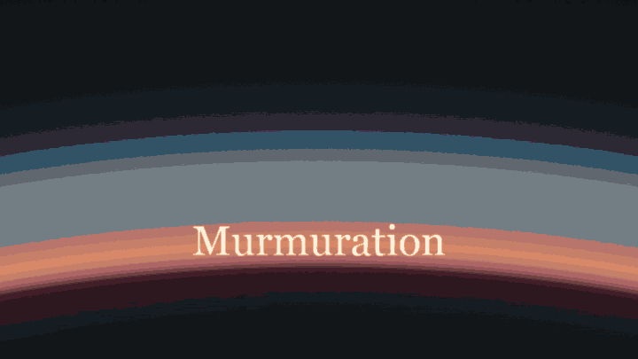

# LittleJS Demos

Showcase demos made with [LittleJS](https://github.com/KilledByAPixel/LittleJS), the tiny fast JavaScript game engine.
Each demo is a self-contained folder with its own copy of the engine, so it runs straight from disk or any web server.

## Demos

### [Murmuration](https://killedbyapixel.github.io/LittleJS-Demos/murmuration/)

40,000 starlings at dusk over a lake, in LittleJS 3D. Steer the hawk with the mouse to scatter the flock.

- **Mouse**: the hawk follows it, click to strike (the first click also starts the sound)
- **G**: the flock flies away over the mountains, then returns
- **F**: free camera (WASD to move, drag to look, Q/E down and up, Shift faster)
- **R**: a new flock
- **A**: hawk autopilot on/off
- **Space**: slow motion
- **H**: hide the text
- **Mouse wheel**: more or fewer birds

Add `?cinematic` to the URL to play the 32 second sequence from the video.

Source: [murmuration/index.html](murmuration/index.html)

## License

MIT, see [LICENSE](LICENSE).
